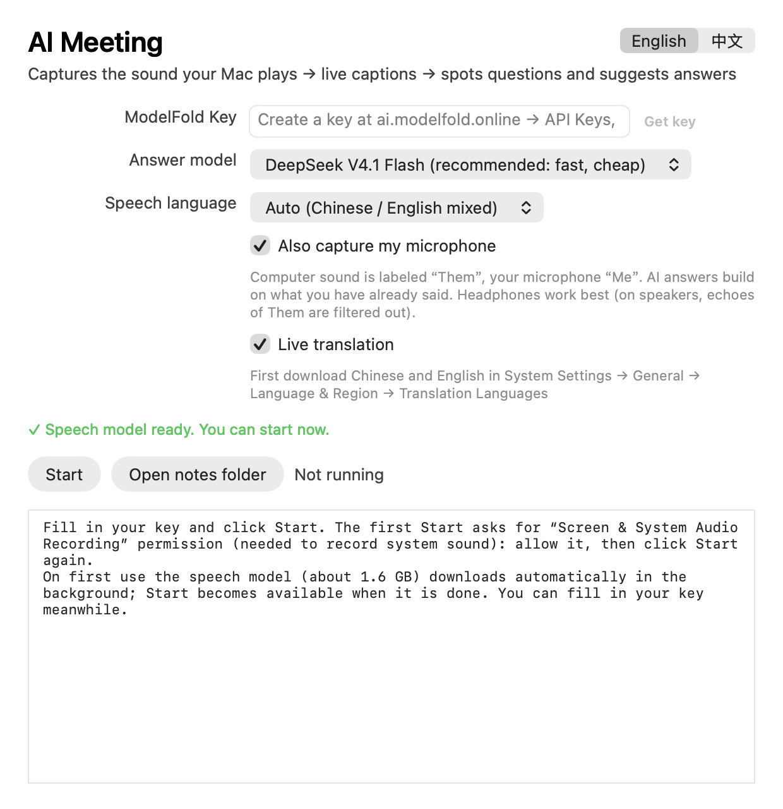
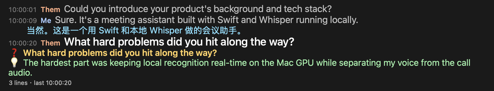
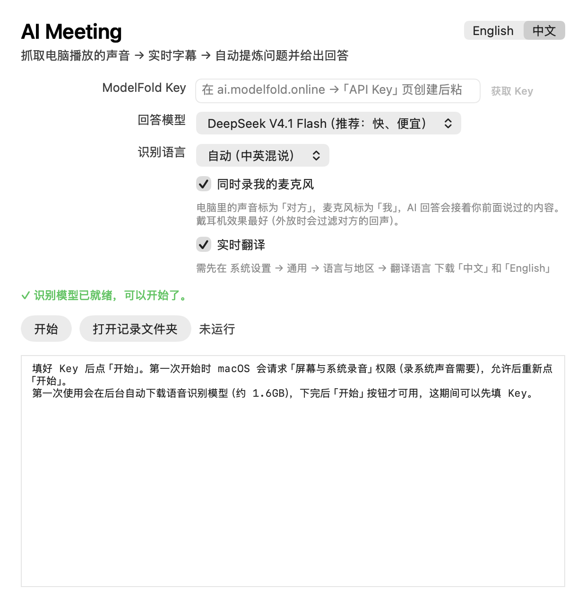
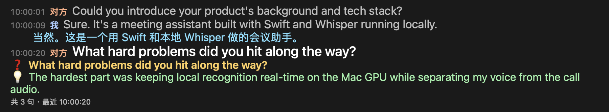

# AI Meeting

**AI 问答由 [ModelFold](https://ai.modelfold.online/?ref=github) 提供 · AI answers powered by ModelFold**

[获取 ModelFold Key / Get an API key](https://ai.modelfold.online/account?tab=keys&ref=github) · [注册 / Sign up](https://ai.modelfold.online/signup?ref=github) · [下载 / Releases](../../releases)

Native macOS live captions, local speech recognition, translation and AI meeting Q&A. MIT licensed.




## English

### Features

- Capture system audio and optional microphone; label the other speaker and yourself separately.
- Local whisper.cpp speech recognition; floating live captions and local Markdown meeting notes.
- Optional macOS translation (download the system language packs first).
- ModelFold detects questions and suggests answers using recent transcript context.
- English/Chinese UI, background model downloads with resume and checksum verification.

### Requirements

- Apple silicon: **macOS 26 or newer** for the distributed arm64 app.
- Intel: **macOS 15 or newer**, AVX2/FMA CPU; translation requires macOS 26. Recognition is CPU based and may lag on slower machines.
- Screen & System Audio Recording permission; Microphone permission if microphone capture is enabled.
- Initial model download: about 1.6 GB on Apple silicon; about 190 MB (small) or 60 MB (base) on Intel.
- ModelFold account, API key and available credits for AI Q&A. Speech recognition runs locally; Q&A sends recent transcript text to ModelFold and consumes credits. Do not use for recordings you lack permission to process.

### Download and install

1. Open [Releases](../../releases/tag/v1.1), choose `AI-Meeting-1.1-mac-arm64.dmg` or `AI-Meeting-1.1-mac-intel.dmg`.
2. Drag AI Meeting into Applications. These builds are not notarized. If macOS blocks it, use System Settings → Privacy & Security → Open Anyway, only after checking the source and release checksums.
3. Launch and allow the model download to finish. Grant recording permissions when starting capture.
4. [Sign up for ModelFold](https://ai.modelfold.online/signup?ref=github), [create an API key](https://ai.modelfold.online/account?tab=keys&ref=github), and paste it into the app's Key field. Choose the model, then Start.

The packaged app keeps configuration in `~/Library/Application Support/AI Meeting`, notes in `~/Documents/AI Meeting Notes`, and logs in `~/Library/Logs/AI Meeting.log`. Keys are stored locally in the configuration file; do not share it. Never commit transcripts or keys.

### Build from source

Install Apple's Xcode command line tools and Homebrew, then:

```sh
brew install node whisper-cpp cmake
cp config.example.json config.json
# Edit config.json: set modelfold.api_key to your own key (optional for captions).
```

For the command-line launcher, download a model separately (not included in Git):

```sh
mkdir -p models
curl -fL --retry 3 -o models/ggml-large-v3-turbo.bin \
  https://huggingface.co/ggerganov/whisper.cpp/resolve/main/ggml-large-v3-turbo.bin
chmod +x start.sh app/build.sh
./start.sh --lang en
```

If Hugging Face is inaccessible, replace its hostname with `hf-mirror.com`. Intel users can download `ggml-small-q5_1.bin` instead and pass `--model models/ggml-small-q5_1.bin`. The CLI reads the nested `modelfold` settings in `config.json`; the GUI manages its own flat configuration. Environment variables `MODELFOLD_API_KEY`, `MODELFOLD_BASE`, `MODELFOLD_MODEL` are also supported by the engine.

Build the distributable (models download on first launch):

```sh
app/build.sh                         # Apple silicon, on macOS 26
ARCH=x86_64 app/build.sh             # Intel cross-build, macOS 15 target
# Optional: SIGN_IDENTITY='Your signing identity' app/build.sh
node --test test/engine.test.mjs     # Mocked engine tests, no paid API calls
```

Apple silicon packaging uses the installed Homebrew whisper.cpp/ggml/libomp and the installed Node executable. Use an official standalone Node binary (`NODE_SRC=/path/to/node`) if yours depends on Homebrew libraries. Intel packaging downloads an official Node binary and compiles whisper.cpp from source. The default signing is ad-hoc; use your own certificate for stable recording permissions. Output goes to `app/dist` or `app/dist-intel`. `BUNDLE_MODEL=1` optionally includes models. Third-party runtimes/models retain their own licenses; this repository's MIT license covers its original source. Prebuilt v1.1 assets are the existing application distribution, not rebuilt from this repository; this source adds referral links and portable signing setup.

## 中文

### 功能

- 采集系统声音，可选录制麦克风；区分「对方」与「我」。
- whisper.cpp 本地语音识别、悬浮实时字幕、本地 Markdown 会议记录。
- 使用 macOS 翻译能力（先下载系统语言包）；识别问题并通过 ModelFold 给出参考回答。
- 中英双语界面；识别模型后台下载、断点续传与校验。

### 系统要求

Apple 芯片安装包要求 **macOS 26+**；Intel 要求 **macOS 15+、AVX2/FMA**，Intel 的实时翻译需要 macOS 26，较慢 CPU 可能识别滞后。需要屏幕与系统录音权限，开启麦克风时还需麦克风权限。首次下载模型：Apple 芯片约 1.6 GB，Intel small 约 190 MB / base 约 60 MB。

语音识别在本机运行；AI 问答会把近期转写文本发送给 ModelFold，并消耗账户积分。请只处理已获授权的录音内容。




### 下载安装与 Key 设置

1. 在 [v1.1 Release](../../releases/tag/v1.1) 下载对应架构的 dmg，将 AI Meeting 拖入「应用程序」。
2. 安装包未公证；确认来源及校验值后，如被系统拦截，到「系统设置 → 隐私与安全性 → 仍要打开」。
3. 打开后等待模型自动下载完成，开始录制时授予对应权限。
4. [注册 ModelFold](https://ai.modelfold.online/signup?ref=github)，[创建 Key](https://ai.modelfold.online/account?tab=keys&ref=github)，粘贴到应用 Key 栏，选好模型后开始。

配置保存在「~/Library/Application Support/AI Meeting」，记录在「~/Documents/AI Meeting Notes」，日志在「~/Library/Logs/AI Meeting.log」。Key 保存在本机配置文件中，请勿分享配置或提交会议记录。

### 从源码运行与打包

安装 Xcode 命令行工具和 Homebrew 后，执行上方英文部分的构建命令即可。先 `brew install node whisper-cpp cmake`，复制 `config.example.json` 为 `config.json` 并填自己的 `modelfold.api_key`。命令行版需按上述 curl 命令下载模型，再运行 `./start.sh --lang zh`；Intel 可下载 small 模型并使用 `--model` 指定。无 Key 时仍可使用本地字幕。

`app/build.sh` 打包 Apple 芯片版；`ARCH=x86_64 app/build.sh` 打包 Intel 版。默认临时签名，稳定的权限识别需自行提供签名证书。打包版首次启动自动下载模型，源码仓库不包含模型、运行时二进制或 dmg。配置、模型、会议记录、缓存均已加入忽略规则。原始源码采用 MIT；依赖和模型遵循各自协议。v1.1 安装包沿用已有发行版本，未从本开源目录重打；本目录另有引流链接与通用签名配置调整。
